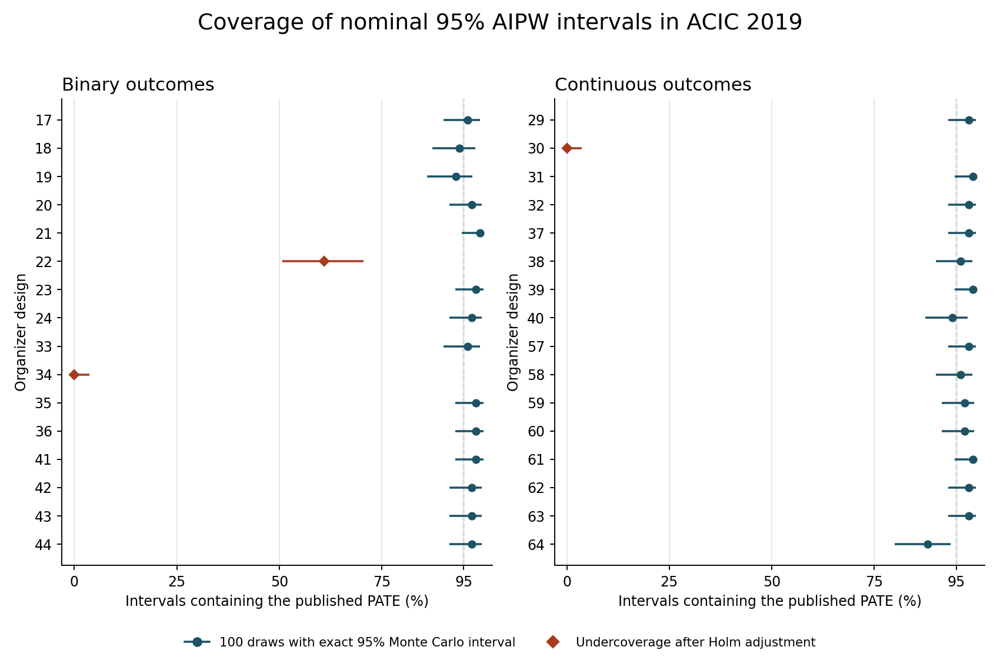

# When does the 95% interval cover the effect? ACIC 2019

The nominal 95% interval covered the published population average treatment effect (PATE) in **2,869 of 3,200** low-dimensional contest files (89.7%). The median design covered **97 of 100** draws. Two designs missed the effect **100 times out of 100**, and a third covered it only **61 times**. All three rejected nominal coverage after adjusting for the 32 designs. Every fit completed. We tested fivefold cross-fitted augmented inverse-probability weighting (AIPW) with ridge outcome regressions, logistic treatment probabilities and a cross-sectional influence-score interval. [All 32 designs](by-design.csv) · [Frozen protocol](protocol.md) · [Organizer's challenge](https://sites.google.com/view/acic2019datachallenge/data-challenge)

## What failed

Each row below summarizes 100 draws from a single generator. The empirical SD measures how much the estimates actually varied across draws. The mean reported SE measures how much uncertainty the estimator assigned to one draw. We selected these examples after seeing the results to distinguish poor centering, inaccurate uncertainty and limited overlap. [Every estimate and interval](draws.csv) · [Designs and generators](designs.md)

| Design | Published effect | Mean AIPW estimate | Empirical SD | Mean reported SE | Intervals covering truth |
|---|---:|---:|---:|---:|---:|
| 22 · Credit, binary | 0.1585 | 0.3191 | 0.4068 | 0.2488 | 61/100 |
| 29 · Catheterization covariates, continuous | 4.000 | 4.015 | 0.438 | 0.434 | 98/100 |
| 30 · Same source, continuous | 10.000 | 21.852 | 0.580 | 0.646 | 0/100 |
| 31 · Same source, continuous, poor overlap | 2.000 | 2.036 | 0.858 | 0.991 | 99/100 |
| 34 · Same source, binary | 0.0496 | −0.0562 | 0.0154 | 0.0194 | 0/100 |
| 64 · Student performance, continuous | 3.625 | 3.827 | 0.218 | 0.252 | 88/100 |

- **Bias dominates in 30 and 34.** Every interval in 30 lay above truth. Every interval in 34 lay below it, and the mean estimate had the wrong sign. Their mean reported SEs already exceeded the empirical SDs. Both generators use nonlinear functions in assignment and outcome. Design 30 even has a constant additive effect. The repo's ordinary partially linear regression (PLR) estimate averaged 22.115 there against the same true effect of 10. The failure can arise before introducing time dependence, treatment-effect heterogeneity or a change in the target population. [Design crosswalk](designs.md) · [Estimates](by-design.csv)
- **Design 22 has two problems.** The estimate averaged 0.161 above the true risk difference, and its empirical SD was 1.64 times its mean reported SE. The generator can duplicate whole observations during resampling. Its file structure makes a row-independent SE and row-level folds worth examining, although this comparison cannot apportion the two problems among resampling, weighting and model specification. [Generator and row checks](designs.md)
- **Design 31 illustrates the cost of high coverage.** It covered 99 times, yet inverse weighting reduced the effective treated sample size to 10.5% of the treated count on average. Effect RMSE was 0.854, compared with 0.402 for the simple mean of the cross-fitted arm contrasts. [Point errors and overlap](by-design.csv)



The horizontal bars are pointwise exact 95% binomial intervals for Monte Carlo coverage. Zero hits out of 100 gives a range of 0–3.62%. For 61 hits the range is 50.7–70.6%. The diamonds mark rejection in a separate, one-sided test with Holm adjustment across all 32 designs. Design 64 had 88 hits and an adjusted p-value of 0.124. A design that escaped rejection can still have materially subnominal coverage. The 89.7% overall rate describes the organizers' equally represented designs. Extrapolation to other studies would require a sampling model for the designs themselves. [All intervals and adjusted p-values](by-design.csv)

## What prediction and the simple comparators tell us

In design 30, the held-out marginal outcome MSE beat the fold-training mean baseline by 39.1% on average. Treatment Brier loss beat the fold-training prevalence baseline by 14.8%. **No fitted probability triggered clipping in any of the 100 files.** All 100 effect intervals still missed. A logistic model can keep its predictions away from zero and one while systematically misestimating which units receive treatment. Factual prediction loss also gives little direct information about how well an arm model predicts the other arm's counterfactual outcomes. [Per-draw scores, support and arm-specific factual losses](draws.csv)

Within each design we ranked its 100 draws by prediction skill and by absolute effect error, using the same learners throughout. Spearman correlations ranged from −0.334 to +0.203 for marginal outcome skill and −0.280 to +0.230 for propensity skill. The medians were −0.010 and −0.031. These figures answer whether an easier-to-predict draw also yielded a more accurate effect. Comparing different learner families on a common draw is a separate experiment. Bach and colleagues used this same challenge to study exactly that tuning and model-choice question. [Within-design correlations](by-design.csv) · [Bach et al., 2024](https://proceedings.mlr.press/v236/bach24a.html)

For point estimation, **standardization had lower measured RMSE than AIPW in all 32 designs**. Standardization uses the same held-out ridge predictions and averages each row's predicted treated-minus-control outcome. AIPW adds inverse-probability-weighted factual residuals. This paired comparison isolates the impact of adding that correction with these particular fitted models. AIPW beat the unadjusted arm difference in 11 designs. The table includes the paired difference in squared error and its Monte Carlo SE so that small differences can be distinguished from reproducible gains. We assessed interval coverage only for AIPW. [Paired comparisons](by-design.csv)

### Changing only the treatment probabilities in design 30

We selected design 30 for an exploratory follow-up because its known effect was constant and all 100 draws shared the same 5,735 covariate profiles in exactly the same order. We used treatment assignments from 50 draws to estimate how often each profile received treatment. We then held arm predictions fixed in the other 50 draws and changed only the probabilities in the AIPW score. The original and replacement methods were scored on the same 50 evaluation files. [Reproduction script](reference_propensity.py) · [Paired results](reference-propensity.csv)

| On 50 evaluation draws, true effect 10 | Original logistic fit | Profile frequencies from 50 other draws |
|---|---:|---:|
| Mean treatment Brier loss | 0.18374 | 0.14001 |
| Mean effect estimate | 21.826 | 8.247 |
| Effect RMSE | 11.840 | 2.224 |

The replacement reduced absolute effect error in every evaluation draw. The mean paired estimate change was −13.579, with Monte Carlo SE 0.167 conditional on this one set of reference assignments. The replacement undershot the true effect by 1.753 on average. This isolates sensitivity to the propensity estimates. It uses information unavailable in an ordinary observational sample and leaves uncertainty from estimating the reference frequencies unmeasured. [Full results](reference-propensity.json)

## What carries over to time-forward evaluation

The 16 development examples served as implementation checks. The competition adds repeated draws, an organizer-supplied target for each file and a way to falsify a coverage claim. Twenty designs hold the covariates fixed across draws. Twelve resample source observations. All are simulations with observed pretreatment confounders. File numbers give no order in which treatments were assigned or outcomes became available. The official high-dimensional contest is outside this analysis. [Development study](../2026-11-21_evaluation_methods/external-control.md) · [Design crosswalk](designs.md) · [Organizer FAQ](https://sites.google.com/view/acic2019datachallenge/faq)

For a rolling study, keep two records at each origin. Score frozen outcome and treatment predictions when the next block's factual labels mature. Separately, freeze an effect for a named intervention, horizon, eligible population and weighting rule. Compare it with an independently identified effect on those same terms in the later block, retaining the uncertainty of that benchmark and accounting for shared units or overlapping origins. A later randomized contrast can supply that reference. A known-effect time-series simulation can additionally test interval coverage over new paths. Without either reference, the defensible result is a measure of predictive performance or variation in estimates over time. Stability alone cannot identify the effect. [Evaluation matrix](../2026-11-21_evaluation_methods/evaluation-matrix.md) · [Forward protocols and examples](../2026-11-21_evaluation_methods/forward-validation.md)

## Reproduce

From the repository root, set `cache` to the directory containing the original low-dimensional contest data ZIP and organizer results ZIP. The driver verifies both digests, the frozen protocol and the full truth roster. The primary run used 10 independent worker processes, with one numerical thread each. [Low-dimensional observations](https://dl.dropboxusercontent.com/s/g0elnbfmhbf7rr3/low_dimensional_datasets.zip) · [Organizer results ZIP](https://drive.google.com/open?id=1GnZMX9tQp8-n1DRGsIf4DGGtO_3DrDu5) · [Versions and hashes](run.json)

```bash
study=docs/audits/2026-11-22_acic_coverage
cache=/path/to/acic-downloads
out=$(mktemp -d)
observed="$cache/low_dimensional_datasets.zip"
truth="$cache/ACICDataChallenge2019.zip"
PYTHONPATH=. .venv/bin/python "$study/run.py" "$observed" "$truth" "$out" --jobs 10
.venv/bin/python "$study/verify.py" "$observed" "$truth" "$out"
.venv/bin/python "$study/reference_propensity.py" "$observed" "$truth" "$out"
.venv/bin/python "$study/plot.py" "$out/by-design.csv" "$out/coverage.png"
cmp "$study/draws.csv" "$out/draws.csv"
cmp "$study/by-design.csv" "$out/by-design.csv"
```

An independent reconstruction checked all 3,200 truth joins, interval endpoints and coverage decisions, then refit one prespecified file per design from the raw observations. The largest discrepancy in those 32 estimates, SEs and endpoints was 6.93 × 10⁻¹⁴. A second full run with four workers produced byte-identical draw and design tables. Replaying the 16-file development audit also reproduced its original CSV byte for byte. [Independent verification](verify.py) · [Development results](../2026-11-21_evaluation_methods/additional/acic-results.csv)
